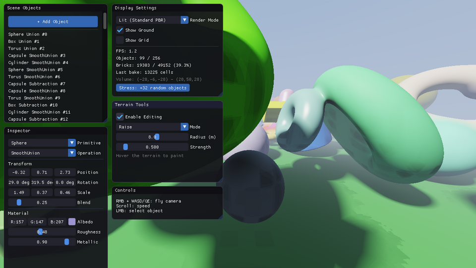

# SDF Playground

A Vulkan editor for building scenes out of signed distance field (SDF) primitives combined with CSG operations, plus an editable heightfield terrain. Objects are rendered by GPU raymarching through a sparse brick volume. ImGui provides the editor, and Jolt Physics is linked and stepped every frame (no bodies yet).



## What works today

- **Edit list**: up to 256 primitives (sphere, box, torus, capsule, cylinder). Each one has position, rotation, scale and a material, and is combined with union, subtraction, intersection, smooth union or smooth subtraction.
- **Sparse brick volume**: the edit list is baked on the GPU into 8³ distance bricks, allocated only where a surface passes through. The raymarcher skips empty space using a sparse cell map and samples bricks with hardware trilinear filtering. When an edit changes, only the cells around it are re-baked. See [docs/architecture.md](docs/architecture.md).
- **Hit-point detail**: surfaces are snapped to the exact analytic SDF at the hit point, so normals, materials and picking stay exact even though marching uses the voxel cache.
- **Editor**: scene list, inspector (including rotation), click-to-select, render modes (Lit / Normals / Complexity / Bricks), brick-usage statistics.
- **Terrain**: 256 × 256 m heightfield with Raise / Lower / Flatten / Smooth / Paint brushes and 4 splat layers.

Performance, measured with the CPU rasterizer (lavapipe) at 320×180 on the same random scene and camera. This is not a GPU number, but it shows the scaling:

| Objects | Brute force (previous) | Brick volume | Speed-up |
|---:|---:|---:|---:|
| 16 | 159 ms | 51 ms | 3.1× |
| 64 | 476 ms | 83 ms | 5.8× |

To measure on your own GPU: `Engine --bench 96` (optionally `--bench-res 1920 1080`).

## Building

Requirements: CMake 3.20+, a C++20 compiler, and the Vulkan SDK (1.3+ headers, `glslc`). GLFW, GLM, Jolt and ImGui are fetched automatically. You need a GPU with Vulkan 1.3 and dynamic rendering.

```sh
cmake -S . -B build -DCMAKE_BUILD_TYPE=Release
cmake --build build -j
./build/Engine          # Windows: build\Engine.exe
```

Shaders are compiled to `build/shaders/` and found automatically wherever you run the executable from.

Options:

- `SDF_VALIDATION=1` (environment variable) enables the Khronos validation layer in any build. Debug builds enable it by default.
- `-DSDF_PORTABLE_CPU=ON` builds Jolt without AVX2/FMA/F16C, for older CPUs.

## Controls

| Input | Action |
|---|---|
| RMB + WASD / Q E | Fly camera |
| Scroll | Camera speed |
| LMB | Select object (or paint terrain while the terrain tool is on) |

## Limits

- Geometry is clipped to the brick volume: a 56 m cube from (-28, -6, -28) to (28, 50, 28), with a 5 cm voxel size. Object positions are clamped into it.
- The atlas holds 49,152 bricks (48 MB). Very large or very many surfaces can run out of bricks. The Display panel shows usage and reports dropped cells.
- Changing an *intersection* edit re-bakes the whole volume, because intersection clips everything.
- Terrain is a heightfield sampled directly by the raymarcher. It is not part of the brick volume.
- Physics: Jolt is initialized and stepped, but no SDF or terrain collision exists yet.

## Documentation

- [Architecture](docs/architecture.md): brick volume, bake passes, frame flow
- [Rendering](docs/rendering.md): raymarcher, shading, picking
- [Roadmap](docs/roadmap.md): what is planned and not built
