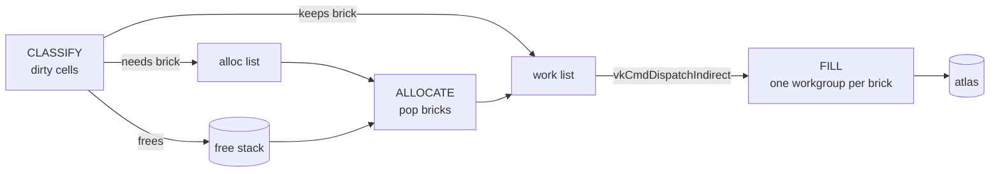

# Architecture

This page describes what the code does today. Planned work is in [roadmap.md](roadmap.md).

## Source layout

| Path | Role |
|---|---|
| `src/core/VulkanContext.*` | Instance/device (Vulkan 1.3 + dynamic rendering), swapchain recreation, frames in flight, validation messenger |
| `src/core/SDFEdit.hpp` | The edit struct (96 bytes, uploaded verbatim to the GPU) and `editBoundRadius()` |
| `src/renderer/SDFRenderer.*` | Owns the per-frame buffers, diffs edits against what is baked, records bake + raymarch |
| `src/renderer/BrickVolume.*` | Sparse map, brick atlas, free-brick stack, bake pipeline |
| `src/renderer/Terrain.*` | Heightmap/splatmap and the brush compute pass |
| `src/editor/EditorUI.*` | ImGui panels |
| `shaders/include/sdf_common.glsl` | Primitives, CSG ops, culling, volume addressing (shared by bake + raymarch) |
| `shaders/BrickBake.glsl` | The four bake passes |
| `shaders/SDFCompute.glsl` | The raymarcher |
| `shaders/TerrainBrush.glsl` | Terrain brushes |

## The edit list

The scene is an ordered list of `SDFEdit`s. Each edit is a primitive in local space (with a quaternion rotation) combined into the running result with one CSG operation. The order matters. The CPU list is the source of truth. Every frame it is sanitized (rotation normalized, position clamped into the volume) and copied into that frame's edit buffer.

## Sparse brick volume

The volume is a 160³ grid of **cells**, each 0.35 m on a side. A cell either owns a **brick** or is empty.

- **Brick**: 8×8×8 distance samples of the cell (7 voxel intervals of 5 cm). The samples include the cell's border, so neighbouring bricks duplicate their shared face. Hardware trilinear filtering therefore never reads across a brick edge, and the field is seamless. Samples are clamped to ±1 cell.
- **Atlas**: an `R16_SFLOAT` 3D texture holding 32×32×48 bricks (256×256×384 texels, 48 MB).
- **Sparse map**: an `R32_UINT` 3D texture with one value per cell:
  - `0x80000000 | brickId` if the cell has a brick;
  - otherwise the float bits of a **safe skip distance**. No surface is closer than this to any point in the cell. It is capped at 4 cells.

A cell gets a brick if the surface is within half a cell diagonal plus 1.75 voxels of its center. The extra margin keeps trilinear and normal taps inside allocated bricks.

### Bake passes (`BrickBake.glsl`)

All four passes run in one pipeline, selected by a push constant:



1. **INIT** (once): fill the free stack with every brick id.
2. **CLASSIFY**: one thread per dirty cell evaluates the edits at the cell center. Cells that no longer need a brick push it back to the free stack and store a safe distance. Cells that need one either keep theirs (and queue a refill) or append themselves to the alloc list.
3. **ALLOCATE**: pops bricks with a lock-free compare-and-swap loop, writes them into the map and queues a fill. Pushes happen only in CLASSIFY and pops only in ALLOCATE, so the stack never sees both at once. If the atlas is full, the cell is left empty and counted as overflow.
4. **FILL**: one 512-thread workgroup per queued brick. The threads first cull edits that cannot reach the brick (bounding sphere + blend radius + clamp band, kept in shared memory), then each thread evaluates one sample. The work-list header doubles as the `VkDispatchIndirectCommand`.

### Dirty tracking

`SDFRenderer::uploadEdits` compares each sanitized edit with the copy that was last baked. For every edit that changed, was added or was removed, it marks the edit's bounding sphere, both old and new, as dirty. The padding covers the classify search radius. Changing an intersection edit marks the whole volume dirty. The dirty cells are re-baked in the same frame.

All bake evaluations use **band culling**: an edit is skipped if it cannot change the field inside `[-band, band]`, and the result is clamped to that band. This is exact inside the band and a conservative bound outside it.

## Frame flow

```
beginFrame()                 wait this slot's fence, acquire image (recreate swapchain if needed)
renderer.beginFrame(slot)    read this slot's picking result + brick stats (GPU is done with them)
editor.buildPanels()         ImGui; may change edits / queue a terrain brush
renderer.render(cmd, slot)   upload edits -> terrain brush -> bake dirty bricks -> raymarch
endFrameBlit()               output image -> swapchain
editor.endFrame()            ImGui draw (dynamic rendering)
endFramePresent()            submit + present
```

Anything the CPU writes or reads while the GPU may still be using it is per frame in flight (edit buffers, selection buffers, stats). The atlas, sparse map and terrain images are shared, and each pass that touches them starts with a barrier against the previous pass. This was checked with the validation layer's synchronization validation, with no hazards reported.

## Terrain

A 1024² `R32F` heightmap plus an `RGBA8` splatmap cover 256 × 256 m centered on the origin. Brushes are dispatched only over the brush rectangle. Smooth first copies that rectangle to a scratch image and reads neighbours from the copy, so invocations never read texels another invocation is writing. The raymarcher samples the heightmap directly, as a conservative half-step heightfield. Terrain is not stored in bricks.
