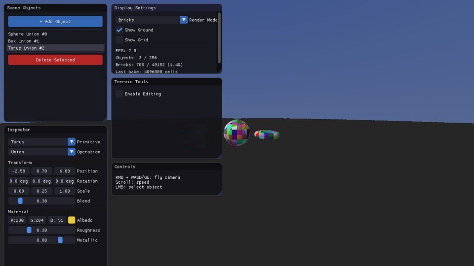

# Rendering

Everything is drawn by one compute shader (`shaders/SDFCompute.glsl`) into an `RGBA8` image. The image is blitted to the swapchain, and ImGui is drawn on top.

## Marching

Each pixel marches a ray (at most 192 steps, up to 200 m). At every step it takes the minimum of two distances:

- **Edit field**, from the sparse map:
  - brick cell: trilinear sample of the atlas brick;
  - empty cell: `max(safe distance, distance to the cell's far side)`, so an empty cell is crossed in one step;
  - outside the volume: distance to the volume box.
- **Terrain**: `(p.y - height) * 0.5`.

A hit only counts if the sample came from a brick, or from the terrain.

## Resolving a hit

The brick field is a 5 cm voxel approximation. At the hit point, the edit list is evaluated analytically with band culling, so the per-pixel cost only depends on nearby edits:

1. Two refinement steps along the ray snap the hit onto the exact surface.
2. Normal: tetrahedron technique (4 taps) on the analytic field.
3. Material: albedo, roughness and metallic, blended for smooth union, from the same evaluation.
4. Picking: the 1-based index of the dominant edit (0 = terrain).

Soft shadows (one directional light) and AO march the brick field, not the edit list.

## Render modes

| Mode | Shows |
|---|---|
| Lit | Two lights, soft shadow, AO, fog, ACES tonemap |
| Normals | World normal |
| Complexity | March step count heatmap |
| Bricks | Each brick in a different colour: shows the atlas allocation |

## Picking

The mouse position is passed in push constants every frame. The one pixel under the cursor writes `{hitIndex, position}` into that frame's selection buffer. The CPU reads it after the slot's fence has signalled, two frames later, and then clears it. A hover result is available every frame, which is how the terrain brush tracks the ground. A click is tagged on the frame it was recorded in and delivered through `SDFRenderer::takeClickResult()`.
